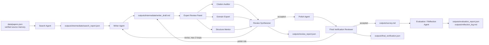
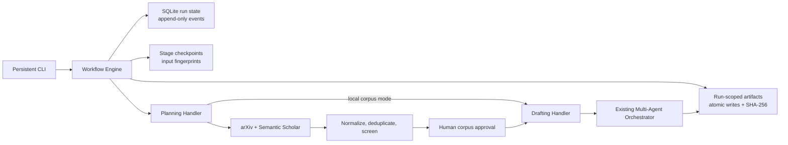

# Design Document

## Project Topic

**Memory-Augmented LLM Agents: Mechanisms, Evaluation, and Reliability in Multi-Agent Systems**

The project builds a multi-agent literature review system that automatically produces a survey on memory mechanisms in LLM agents. The topic was chosen because it matches the system itself: a literature-review pipeline needs persistent source memory, shared intermediate artifacts, citation verification, and reviewer feedback.

## System Goal

The system should complete the path from curated literature corpus to final survey:

1. load a verified paper corpus;
2. group papers by research theme;
3. draft a survey;
4. run an expert-review panel over citation integrity, domain coverage, and structure;
5. synthesize review feedback into a bounded Writer revision loop;
6. polish the accepted draft;
7. run final verification after polish;
8. emit evaluation and reflection artifacts for human submission review.

## Architecture

The architecture uses an orchestrator rather than direct free-form conversation among agents. This keeps the workflow reproducible: each agent reads a known artifact, writes a known artifact, and passes structured state to the next stage. The current implementation is deterministic by default, but the runtime configuration (`AgentRuntimeConfig`) reserves an API-backed path for future agents.

For long-running use, a durable workflow engine wraps the orchestrator:

`Ctrl+C` changes an active run to `paused`; explicit cancellation changes it to
the terminal `cancelled` state. Resume reuses a completed stage only when its
input fingerprint and every output artifact hash still match. Each checkpoint
also stores the next stage, so interruption between checkpoint creation and
state transition does not cause an agent to run twice.

Discovery uses provider adapters behind an injectable HTTP transport. arXiv is
the primary structured source for this computer-science topic; Semantic Scholar
adds cross-index metadata and acts as a secondary source. Raw responses,
queries, candidate provenance, screening scores, and human decisions are
auditable. DOI match has highest deduplication priority, followed by arXiv ID,
Semantic Scholar ID, normalized title and year, and high-similarity title with
overlapping authors. Conflicting years or disjoint authors are not silently
merged.

## Modular Implementation

The implementation now separates responsibilities into focused modules under `src/literature_review/`. `corpus.py` validates and loads the verified paper memory, while `config.py` resolves deterministic or API-backed runtime settings. `search.py` and `writing.py` define the Search, Writer, and Polish roles, and `review.py` groups the expert-panel and final-verification reviewers.

`evaluation.py` computes the evaluation report and reflection content for the completed run. `orchestrator.py` controls the internal agent sequence and writes the review artifacts. `workflow/engine.py` controls durable stage execution, while `storage/sqlite.py` and `storage/artifacts.py` persist state and files. `cli.py` exposes both the legacy one-shot command and persistent run-management commands.

Dependencies flow one way: shared data/config utilities support agent modules, agent modules feed the orchestrator, and the CLI depends on the orchestrator rather than the reverse. The legacy `src/memory_review_pipeline.py` file remains as a compatibility entrypoint that re-exports the modular package API for existing imports and `python -m src.memory_review_pipeline` runs.

## Agent Roles and Handoffs

| Agent | Input | Output | Responsibility | Constraint |
|---|---|---|---|---|
| Search Agent | `data/papers.json` | `search_report.json` | screen and group verified sources | does not write survey prose |
| Writer Agent | `search_report.json`, optional `review_feedback` | `writer_draft.md` | draft or revise the survey from grouped evidence | may cite only corpus keys |
| Citation Auditor | draft, corpus | `citation_audit.json` | check citation keys, claim-source alignment, and required sections | unknown citations and unsupported claims are blocking |
| Domain Expert | draft, corpus, search report | `domain_review.json` | review memory-agent coverage and scholarly framing | advisory unless converted by Synthesizer |
| Structure Mentor | draft | `structure_review.json` | review organization, assignment fit, and readability | advisory unless minimum structure fails |
| Review Synthesizer | panel reviews | `revision_plan.json` | merge feedback into one decision and revision plan | stops on accepted or loop limit |
| Polish Agent | accepted draft | polished Markdown | clean language and spacing | cannot add claims or references |
| Final Verification Reviewer | accepted draft, polished draft, corpus | `final_verification.json` | verify polish did not introduce citations or unsupported claims | rejects unsafe polish output |
| Evaluation / Reflection Agent | run artifacts | `evaluation_report.json`, `reflection_log.md` | score process quality and record lessons | does not change survey content |
| Orchestrator | all artifacts | final outputs | control sequence and revision loop | deterministic fallback when API is absent |

## Communication Format

The agents communicate through shared files:

- `data/papers.json`: long-term source memory with citation keys, metadata, URLs, categories, and contribution notes.
- `outputs/intermediate/search_report.json`: machine-readable Search Agent handoff.
- `outputs/intermediate/writer_draft.md`: current Writer draft before final polish.
- `outputs/intermediate/citation_audit.json`: Citation Auditor result.
- `outputs/intermediate/domain_review.json`: Domain Expert result.
- `outputs/intermediate/structure_review.json`: Structure Mentor result.
- `outputs/intermediate/revision_plan.json`: synthesized revision decision.
- `outputs/review_report.json`: Expert Review Panel package.
- `outputs/final_verification.json`: post-polish safety gate.
- `outputs/revision_log.json`: iteration history.
- `outputs/evaluation_report.json`: structured run evaluation.
- `outputs/reflection_log.md`: readable process reflection.
- `outputs/survey.md`: final generated survey.
- `.review-workflow/workflow.db`: persistent run, event, and checkpoint state.
- `.review-workflow/artifacts/runs/<run_id>/`: atomic run-scoped inputs and final outputs.

JSON is used when downstream agents need reliable fields. Markdown is used when humans need to read or submit the result.

## Workflow Description

The workflow begins with `data/papers.json`, which acts as the system's verified source memory. Each paper record includes a citation key, title, authors, year, venue, URL, category, contribution summary, evidence note, and tags. The Search Agent reads this corpus and groups papers by research role, such as memory mechanism, memory evaluation, memory reliability, and multi-agent or embodied memory. It then writes a structured `search_report.json` file rather than a prose summary.

The Writer Agent reads `search_report.json` and generates `writer_draft.md`. It organizes the survey around the chosen topic, "Memory-Augmented LLM Agents: Mechanisms, Evaluation, and Reliability in Multi-Agent Systems." The Writer Agent is not allowed to invent references: every citation must use a citation key that already exists in the corpus.

The Expert Review Panel then checks the draft from three angles. The Citation Auditor parses bracketed citation keys and verifies that every key exists in `data/papers.json`. It also performs a lightweight claim-level alignment check: a cited sentence must share enough meaningful terms with the cited paper's title, contribution, category, and tags. The Domain Expert checks whether the survey covers memory mechanisms, evaluation, multi-agent reliability, and human governance. The Structure Mentor checks organization, assignment fit, and readability.

The Review Synthesizer converts these reviews into one revision plan. Citation integrity is treated as a hard gate because fabricated or mismatched references are the easiest way for this project to fail. Domain and structure comments are recorded as expert feedback; they improve the process record without making the deterministic course project brittle. If blocking issues exist, the Orchestrator passes the synthesized feedback back to Writer. If the draft is accepted, the Polish Agent performs final cleanup.

Polish is not the end of the pipeline. The Final Verification Reviewer compares the accepted draft with the polished draft and rejects the polish output if it introduced new citations, unknown citations, unsupported claim-citation pairs, or missing sections. This protects against a common failure mode: a style agent making a flawed sentence sound more authoritative. Finally, the Evaluation / Reflection Agent writes a score-style report and a readable reflection log.

The persistent execution path adds a Planning stage before this agent sequence.
It stores the research request, corpus path, and sanitized runtime
configuration. Drafting then executes the existing orchestrator in a temporary
directory and imports the six final artifacts only after that execution
succeeds. Stage transitions and failures are recorded as immutable events.

## Reviewer-Writer Feedback Loop

The Writer, Expert Review Panel, and Review Synthesizer form a bounded revision loop:

1. Writer creates a draft from verified sources.
2. Citation Auditor checks bracketed citation keys and basic claim-source alignment.
3. Domain Expert and Structure Mentor add expert feedback.
4. Review Synthesizer merges all reviews into `accepted` or `revise`.
5. If unknown citations, unsupported claims, or missing required sections exist, the draft is marked `revise`.
6. The orchestrator allows at most two revision loops before stopping.

The termination condition is explicit: `accepted` status from Review Synthesizer or the revision-loop limit. Synthesized feedback is passed back to Writer on the next iteration, so the loop is not merely structural; it can change the next draft. After this loop, Final Verification is a separate safety gate rather than another writing loop; if polish creates risk, the system retains the accepted pre-polish draft.

## Hallucination Control

The most likely failure in an automated survey system is fabricated citation. The project uses eight controls:

1. All references are stored in `data/papers.json` before drafting.
2. The Writer Agent can cite only corpus citation keys.
3. The Citation Auditor rejects unknown citation keys.
4. The Citation Auditor performs a lightweight claim-level alignment check to catch real citations used for unrelated claims.
5. Missing expected sources are emitted as `[MATERIAL GAP: key]` rather than silently replaced with a different paper.
6. The References section is generated from corpus metadata.
7. Polish is followed by Final Verification, which rejects new citations introduced after review.
8. Human review is required if the panel flags unsupported citations or source mismatch.

This design treats memory as a verified blackboard, not a free-form scratchpad.

## API Extension Interface

The current system is intentionally runnable without network access or paid services. Each agent receives a shared `AgentRuntimeConfig`, loaded from environment variables documented in `.env.example`. The configuration layer supports three modes:

- `AGENT_BACKEND=deterministic` keeps the current local behavior.
- `AGENT_BACKEND=api` with `AGENT_API_MODE=single` assigns one default API profile to all agents.
- `AGENT_BACKEND=api` with `AGENT_API_MODE=multi` lets individual agents override the default profile.
- `AGENT_API_BASE_URL`, `AGENT_API_KEY`, `AGENT_MODEL`, `AGENT_TEMPERATURE`, and `AGENT_TIMEOUT_SECONDS` define the default profile.
- Per-agent overrides use prefixes such as `WRITER_AGENT_`, `REVIEWER_AGENT_`, and `POLISH_AGENT_` with suffixes such as `MODEL`, `TEMPERATURE`, `API_KEY`, `API_BASE_URL`, and `TIMEOUT_SECONDS`.

This is a configuration interface, not a requirement that graders run external APIs. The submitted implementation still works locally through deterministic logic. A future version can replace deterministic drafting or reviewing internals with API calls without changing artifact names, citation gates, or tests. In particular, API-backed Writer or Polish agents must still emit the same artifacts and remain subject to citation audit and Final Verification.

## Human Intervention Points

Human intervention is intentionally limited to high-impact decisions:

| Stage | Human role | Reason |
|---|---|---|
| Topic scoping | choose the subfield and research question | topic fit depends on course goals and deadline |
| Seed corpus approval | confirm the core papers are relevant | bad initial corpus leads to bad survey |
| Citation-risk resolution | decide whether to delete, rewrite, or add evidence | automatic agents should not invent sources |
| Final acceptance | judge whether the survey satisfies the assignment | structural checks do not equal academic quality |
| Submission review | confirm files are complete and readable | the human remains responsible for the final upload |

In short, the system is automated by default, but humans intervene at scope, evidence trust, unresolved risk, and final submission.

## What Is Automated

- loading the literature corpus;
- grouping papers by memory mechanism, evaluation, reliability, and multi-agent relevance;
- drafting the survey;
- producing a reference list;
- checking citation keys and basic claim-source alignment;
- logging expert-panel status and revision plans;
- running final verification after polish;
- generating evaluation and reflection artifacts;
- polishing accepted Markdown.
- persisting run state and event history across process exits;
- pausing on keyboard interruption and resuming from verified checkpoints;
- cancelling runs without replaying later stages.

## What Is Not Fully Automated

- judging whether the topic is interesting enough;
- deciding whether a marginal paper belongs in the corpus;
- approving discovered papers and adding scholarly contribution notes;
- downloading and reading every candidate PDF in full;
- verifying full paper content beyond metadata-level and lightweight claim-alignment checks;
- making final academic-quality judgments;
- submitting the assignment.

## Pitfalls and Lessons Learned

The first pitfall was citation hallucination. When a writing agent is asked to produce a literature review without strict constraints, it can generate references that sound plausible but do not exist in the local corpus. This is especially dangerous because fabricated citations are hard to notice once they are embedded in fluent academic prose. The solution was to make `data/papers.json` the only source of truth and to use citation keys as a contract between agents. The Writer Agent can only cite corpus keys, and the Citation Auditor rejects unknown keys. A later improvement also removed citation fallback behavior: when an expected key is absent, the system marks a material gap instead of substituting another real but semantically wrong paper.

The second pitfall was shared-memory contamination. In a multi-agent pipeline, an error made by one agent can become part of the shared workspace and then be reused by later agents. For example, if an unsupported claim enters the draft, the Polish Agent may make it sound more convincing even though the evidence is weak. The project addresses this by separating draft memory from reviewed memory. A draft is not treated as reliable until the Expert Review Panel and Review Synthesizer accept it, and the polished version is not final until the Final Verification Reviewer accepts it.

The third pitfall was stale intermediate artifacts. During development, failed runs left outdated draft and review files in the output folder. This made it harder to tell which artifacts belonged to the latest run. The Orchestrator now separates the current draft, revision logs, and review artifacts so downstream agents and human reviewers can identify the accepted draft and audit trail.

The fourth pitfall was over-automation. A fully autonomous literature review pipeline sounds attractive, but research quality still depends on human judgment. The system therefore keeps automation focused on repetitive and checkable tasks, such as grouping sources, drafting, citation-key checking, and output generation. Human intervention is reserved for high-impact decisions: topic selection, seed corpus approval, citation-risk resolution, final quality judgment, and submission review.

The fifth pitfall appeared during the system refactor: a workflow can look iterative while still being a fake loop. In the first version, the draft-review loop was structurally present, but the design had to be checked carefully to ensure that synthesized feedback actually returned to Writer. The revised system now passes `review_feedback` into the Writer on the next iteration, and the test suite includes a regression test where the first draft deliberately contains a fake citation. The test passes only if the second Writer attempt receives the unknown-citation feedback and removes the fabricated reference.

The sixth pitfall was deciding how much autonomy a long task should have. A real literature-review run may discover that the seed corpus is too narrow and that more papers are needed. However, allowing Writer or Reviewer to add references on its own would create a high risk of citation hallucination. The project therefore treats source expansion as a Search-stage and human-checkpoint issue. If coverage is weak, the system records the need for more literature, but the current run still cites only the verified corpus.

The seventh pitfall was API dependency risk. Adding API support could make the project appear more realistic, but it could also make the final assignment hard to reproduce on another machine and create a risk of exposing private keys. The final design therefore exposes an API configuration interface while keeping deterministic fallback as the default. This preserves a clear upgrade path without making external services necessary for grading. The README also clarifies that `.env` is a local file and should not be submitted, while `runtime_config.json` sanitizes configured API keys.

The eighth pitfall was assuming that a long task could be resumed safely from a
stage name alone. A process may stop after writing outputs but before updating
the next stage, which can replay an expensive agent call. The durable engine
therefore records the input fingerprint, output hashes, completion status, and
next stage in one checkpoint. Resume verifies the files before skipping work;
changed configuration, changed corpus content, or a modified output invalidates
the checkpoint.

## Agent Evaluation and Reflection

Search Agent now has two layers. Discovery queries arXiv and Semantic Scholar,
normalizes metadata, merges cross-provider duplicates, and produces transparent
screening recommendations. The corpus organizer then groups only seed and
human-approved records for Writer. Its main limitation is evidence depth:
provider metadata and abstracts are not equivalent to full-paper verification.

Writer Agent performed well at turning structured source memory into a coherent survey. It produced sections on methodology, taxonomy, mechanism families, evaluation, reliability risks, multi-agent implications, open problems, and references. Its main risk is overgeneralization: it may write claims that sound reasonable but are broader than the corpus supports. For this reason, Writer Agent must remain constrained by citation keys and must be followed by the Expert Review Panel.

Citation Auditor is the most important hard safety component. It checks whether cited keys are present in the verified corpus, whether cited claims are lexically aligned with the cited source metadata, and whether required sections exist. This directly targets the assignment's main risk: hallucinated or misused references. Its current limitation is that the claim-level check is lightweight and metadata-based; it does not yet read full PDFs. A future auditor should verify whether each factual claim is actually supported by the cited paper, ideally using full-text extraction and stronger claim-evidence matching.

Domain Expert and Structure Mentor add a second layer of quality control. They are advisory in the current deterministic version because academic quality feedback can be subjective and should not make the project unable to finish. Their output is still valuable: it becomes part of `review_report.json` and gives the human reviewer concrete points to inspect before submission.

Polish Agent is intentionally limited. It only cleans the accepted draft and does not introduce new evidence. This reduces the risk that a stylistic editing stage adds unsupported claims after review. The trade-off is that Polish Agent is less powerful than a normal rewriting agent, but this is acceptable because reliability is more important than maximal fluency in this assignment.

Final Verification Reviewer protects the post-polish stage. This is important because polishing can make text more fluent while accidentally changing evidence commitments. The current implementation compares citation sets before and after polish and reruns citation auditing on the polished draft. If new citation risk appears, the system keeps the accepted pre-polish draft rather than submitting unsafe prose.

Evaluation / Reflection Agent records process-level performance. It scores citation integrity, claim-source alignment, process control, and literature coverage, then writes a short reflection log. This makes the system more credible as a course artifact because it does not only produce a survey; it also explains how the agents performed and where the system should improve.

Orchestrator performed the role of process controller. It makes the system reproducible by enforcing a fixed sequence, writing intermediate artifacts, recording the review result, passing synthesized feedback back to Writer, and stopping when Review Synthesizer returns `accepted` or the revision-loop limit is reached. Its strongest contribution is preventing hidden state: each major decision is visible in an output artifact. The main limitation is that the workflow is still mostly linear. Future versions could add a planner or memory manager that decides when to re-search, when to request human approval, and when to trigger deeper citation verification.

## Future Improvements

Future versions could improve the system in five directions:

1. Add real API-backed generation while preserving the same artifact contracts, citation gates, and deterministic fallback.
2. Add Crossref or OpenAlex as another structured fallback and enrich DOI metadata.
3. Add full-text PDF extraction so Reviewer can verify claim-reference alignment beyond metadata-level checks.
4. Add a small command-line or web interface for human approval of seed-corpus additions and citation-risk decisions.
5. Extend the modular package with additional interfaces or deeper verification components while preserving the compatibility entrypoint and current artifact contracts.

A more advanced version could also learn memory write/delete policies, but deterministic verification is safer for this course project. The current seed expansion is documented in `docs/seed_corpus_review.md`.

## Repository

GitHub repository: https://github.com/DavidZ05/multi-agent-literature-review-system
