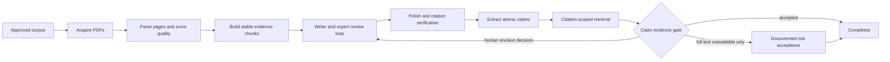

# Workflow Design

This project is a local-first literature review workflow. The command line and
Workbench UI use the same SQLite store, artifact store, approval service, and
persistent workflow engine.

## Discovery Gate

Automatic discovery is intentionally not fully autonomous. arXiv and Semantic
Scholar results are normalized, deduplicated, screened, and stored as candidate
papers. Candidate papers cannot be cited until a human approves them.

The workflow pauses at `awaiting_corpus_approval` in two cases:

1. discovery produced candidate papers that require approve, reject, or defer
   decisions;
2. discovery ran but produced zero approval candidates.

The second case is important. A zero-candidate run may mean the topic is too
broad, the query wording is not scholarly enough, the seed corpus does not match
the topic, a provider is rate limited, or the provider simply returned no useful
records. The system therefore waits for human review instead of silently
drafting a survey from unrelated seed papers.

## Workbench Diagnostics

`WorkbenchService.get_run_detail()` exposes a `discovery_summary` object. The UI
uses it to show:

- whether discovery ran;
- provider query counts, result counts, and failure counts;
- sanitized provider error categories such as `rate_limited` or
  `network_unavailable`;
- candidate and pending counts;
- a lightweight seed-corpus alignment hint;
- recommended next actions.

For zero-candidate discovery runs, the Workbench changes the continuation action
from "Close discovery" to "Continue with seed corpus". This makes the human
decision explicit: continuing means the user accepts drafting from the current
verified seed corpus.

## Failure Policy

- All providers fail: the run enters `retry_wait`; resume retries from the last
  valid checkpoint.
- Some providers fail but at least one provider succeeds: discovery remains
  inspectable, and partial failures are shown in the Workbench.
- Discovery succeeds with zero candidates: the run waits for human review before
  drafting.
- Approved candidates exist: the approval gate builds an augmented corpus and
  drafting uses that corpus.
- No approved candidates and the user closes discovery: drafting uses the seed
  corpus only.

This policy favors transparent research control over hidden automation. The
system can still complete quickly, but only after the user has seen why no new
literature was added.

## Discovery Attempts and Retry

Every discovery execution is stored as a separate attempt under the same
research run. An attempt records its providers, exact queries, maximum results,
timestamps, failure state, and a retrieval funnel. Raw provider artifacts and
the attempt summary are stored under
`discovery/attempts/<attempt_id>/`.

Retry is allowed while the run is waiting at corpus approval or waiting to
retry the original discovery stage. It uses the same per-run execution lock as
resume and deletion, so two retries cannot mutate one candidate pool at the
same time. Retry temporarily returns the run to discovery, then restores the
approval gate. Existing candidates and append-only human decisions are merged,
not replaced. A paper already present in the run is not counted as a new
candidate. If the backend exits during retry, startup recovery marks the attempt
and Job interrupted, restores the previous gate, and appends an audit event.

The default query planner is domain-neutral and produces topic, survey,
evaluation, and reliability variants. Users may replace these with up to eight
exact scholarly queries in either the CLI or Workbench. arXiv converts query
text to a bounded keyword conjunction instead of requiring one long exact
phrase; Semantic Scholar receives the normalized query text directly.

## Full-Text Evidence Path

Full-text verification is an opt-in extension to the durable workflow:

`DocumentRecord` stores acquisition method, source URL, run-relative path,
SHA-256, parser version, page count, extraction quality, and failure code.
`EvidenceChunk` IDs are derived from the document checksum, page range,
character offsets, and chunking configuration. Reprocessing unchanged input is
stable, while changing the PDF or chunking policy changes the evidence identity.

PDF acquisition is limited to HTTPS and validates the PDF signature. It does
not bypass access controls. Before any content is read, the downloader validates
the hostname's resolved addresses and every redirect target, rejecting localhost
and non-public destinations. An unavailable document remains in the manifest so
the final verifier emits `full_text_unavailable` instead of pretending the
source was checked. A user may import a locally available PDF for the same
citation key; import runs under the per-run activity lock, reads only up to the
configured size limit, immediately parses and indexes it, refreshes both
evidence manifests, and replaces the latest claim verification results using
the same contracts. If the citation already has a parsed document, the prior
PDF metadata and chunks are archived before replacement so older claim
verifications keep a resolvable evidence trail.

## Claim Verification Contract

The final polished Markdown is split into versioned `AtomicClaim` records with
section and paragraph positions. Factual and synthesis claims require citation
keys. Retrieval is hard-scoped to evidence chunks whose citation key matches
the claim citation; a passage from another paper cannot satisfy the result.

The deterministic verifier emits `supported`, `partially_supported`,
`contradicted`, `not_found`, `full_text_unavailable`, or `missing_citation`.
It uses material-term coverage, phrase overlap, and a conservative polarity
check. This is an auditable screening gate, not a claim of expert-level natural
language inference. A model-backed semantic verifier may later implement the
same result contract, but cannot change citation scope or bypass blocking
statuses.

All statuses except `supported` block automatic completion. Human
`accept_risk` is valid only if every blocking result for that claim is
`full_text_unavailable`. A human decision records the exact blocking
verification fingerprints it reviewed. If document content or verification
output changes, the old decision remains append-only history but is no longer
active for the gate. All other failures require revision. The gate writes claim
feedback plus the active human decision IDs into
`evidence/revision_feedback.json`. That control artifact is part of Drafting's
input fingerprint, ensuring the next Writer run receives the feedback and an
old checkpoint is not reused.

Claims are versioned across actual survey revisions. Replaying claim
verification for unchanged Markdown reuses the same version, so an interrupted
stage does not invent a new draft. The Workbench and active gate show the latest
version; earlier claims, verification results, and decisions remain in SQLite
and the audit export.

## Audit Export

The export command creates a deterministic ZIP with fixed entry metadata,
sorted paths, run artifacts, source PDFs unless excluded, and
`audit/manifest.json`. Export holds the per-run activity lock while taking the
snapshot. The manifest contains workflow events, discovery attempts, candidate
and corpus decisions, document state, evidence chunks, claims, verification
results, human decisions, archived document history, and SHA-256 hashes for
every included artifact. This supports review and comparison without treating
the ZIP as a new source of truth.
