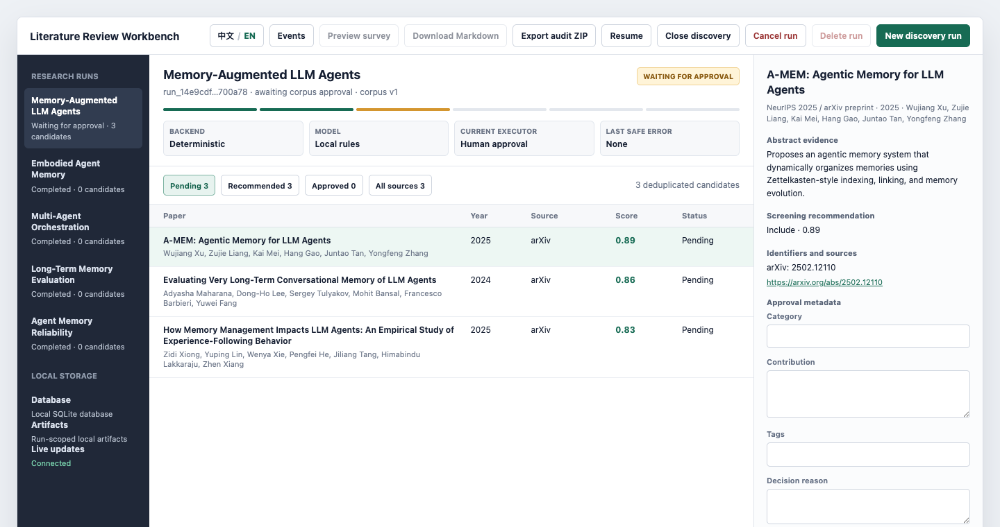

---
hide:
  - navigation
  - toc
---

<div class="lr-hero" markdown>
<p class="lr-kicker">LOCAL-FIRST RESEARCH OPERATIONS</p>

# Multi-Agent Literature Review System

An inspectable workflow for literature discovery, human corpus approval,
multi-agent drafting, citation verification, and reproducible audit export.

<div class="lr-actions" markdown>
[Start locally](getting-started.md){ .md-button .md-button--primary }
[Read the workflow](workflow.md){ .md-button }
[View on GitHub](https://github.com/DavidZ05/multi-agent-literature-review-system){ .md-button }
</div>

<p class="lr-release">Current release: <strong>v0.8.1</strong> · Python 3.11–3.12 · macOS and Linux</p>
</div>

<figure class="lr-workbench-shot">
  
  <figcaption>The local Workbench and CLI share one SQLite workflow state and the same auditable artifacts.</figcaption>
</figure>

## Research workflow, not a chat transcript

The system keeps decisions visible. Literature candidates must be approved
before Writer can cite them, review feedback returns to Writer through a bounded
revision loop, and final verification runs after polishing.

<div class="lr-principles" markdown>
<div markdown>
### Human corpus gate
Discovery results remain non-citable until a human approves their metadata,
category, contribution, and relevance.
</div>
<div markdown>
### Citation integrity
Citation keys, claim anchors, reference coverage, and post-polish semantics are
checked before a run can complete.
</div>
<div markdown>
### Durable execution
SQLite state, checkpoints, artifact hashes, restart recovery, and event history
make interrupted work inspectable and resumable.
</div>
</div>

## One workflow, three surfaces

| Surface | Best for | Contract |
| --- | --- | --- |
| Workbench | Interactive discovery and human approval | Loopback-only local web UI |
| CLI | Automation, inspection, and reproducible operations | Stable commands and equivalent UI actions |
| Audit export | Review, handoff, and archival | Versioned artifacts with decisions and verification results |

## Start without model credentials

```bash
git clone https://github.com/DavidZ05/multi-agent-literature-review-system.git
cd multi-agent-literature-review-system
python3 -m pip install -e .
literature-review doctor
literature-review-workbench
```

Deterministic mode is the default. Remote model APIs are optional and remain
behind the same corpus, citation, and final-verification gates.

[Continue to the quick start](getting-started.md){ .md-button .md-button--primary }
