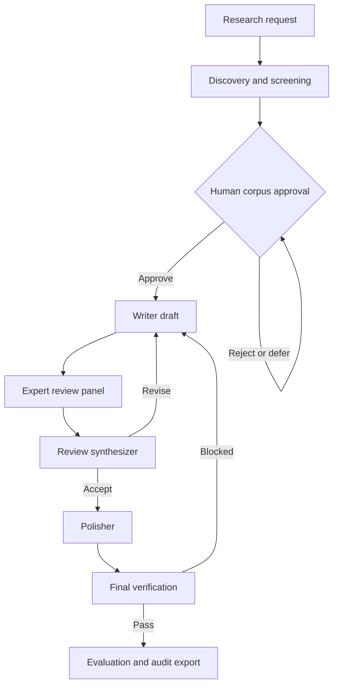

# Workflow

The persistent workflow separates retrieval, human decisions, generation, and
verification. Every executable stage records events and artifacts before the
state machine advances.

## Discovery and screening

arXiv and Semantic Scholar providers normalize results into a shared candidate
contract. The pipeline deduplicates candidates, records provider failures, and
scores relevance without making candidates citable.

## Human corpus approval

An approved candidate receives a deterministic citation key and joins the
validated corpus. Rejected and deferred candidates remain in the decision
history. Material metadata changes invalidate stale approval fingerprints.

## Draft and expert feedback

Writer receives the approved search report. Independent reviewer roles assess
coverage, argument structure, claim-source alignment, and process reliability.
The synthesizer turns those reports into a bounded revision instruction that is
passed back to Writer, not merely logged beside the draft.

## Polish and final verification

Polisher may improve prose but cannot add, remove, or rename citations. Final
verification checks the polished result, including citation integrity and
semantic anchors such as negation, numbers, direction, comparison, and modality.

## Persistent execution

Checkpoints are reused only when input fingerprints match and every recorded
artifact retains its expected SHA-256 hash. Safe Workbench jobs can recover
after backend restart; malformed or exhausted recovery requests fail closed for
human inspection.
